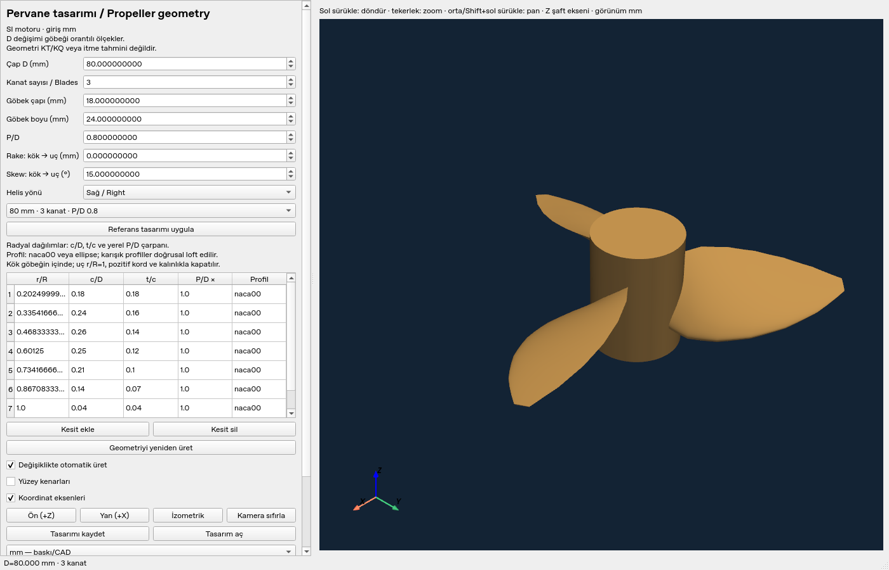

# MarineProp Studio v0.2 — native parametric designer

This is a working **PySide6 + PyVista/VTK** desktop prototype, separate from
`app.py`. It opens a native window and requires no browser or Streamlit server.
The existing hydrodynamic definitions are unchanged. Geometry generates no KT,
KQ, thrust, efficiency or calibrated T60 performance predictions.

## Windows setup (separate environment)

Use Windows x64 with Python 3.12 and an OpenGL-capable display/driver. Keep the
existing `.venv` intact. From PowerShell in the existing project directory:

```powershell
Set-Location 'C:\Users\ayber\OneDrive\Desktop\MarineProp-Studio'
git status --short
git pull --ff-only
# Create only if .venv-cad does not already exist. Do not delete an existing env.
if (!(Test-Path '.venv-cad')) { py -3.12 -m venv .venv-cad }
.\.venv-cad\Scripts\python.exe --version
.\.venv-cad\Scripts\python.exe -m pip install -r requirements-desktop.lock.txt
.\.venv-cad\Scripts\python.exe -m pytest -q
.\.venv-cad\Scripts\python.exe desktop_app.py
```

If `.venv-cad` already uses another Python version, select a new environment
name rather than deleting it. No global pip installation is needed. Python 3.12
Linux installed and ran the CAD dependencies; Windows x64 wheel availability was
also checked. A Windows wheel check is not Windows runtime/driver validation.
The lock file records the actually tested dependency versions;
`requirements-desktop.txt` contains the supported version ranges for upgrades.
The original `.venv\Scripts\python.exe -m streamlit run app.py` still runs the
performance interface without requiring CAD imports.

## Geometry definition

The shaft is +Z; XY is the propeller disk; all core coordinates are metres.
The editor accepts mm (nine decimal places for numeric controls; JSON API stores Python floats). `r/R`, `c/D`, `t/c` and local pitch factors are editable
radial distributions. Local pitch is `P(r) = global(P/D) * pitch_factor(r) * D`.
Piecewise linear interpolation is used between user stations. The root station
must be inside the hub radius, and the last station must be r/R=1.

At each radius, `beta = atan2(P(r), 2*pi*r)`. For developed chord coordinate s
and profile half-thickness h:

```
u = s cos(beta) - h sin(beta)
z = s sin(beta) + h cos(beta) + rake * f
angle = u/r + skew * f
X = r cos(angle); Y = r sin(angle)
f = (r/R - root_fraction) / (1 - root_fraction)
```

Thus pitch, chord, thickness, rake and skew actually change vertex positions.
Sections wrap onto cylinders, so the tip radius remains exactly D/2 before
boolean discretization. Rake is axial displacement, not a rake angle. Skew is
angular displacement, not a length. Right-handed means positive dz/dtheta on the
developed chord helix; left-handed mirrors Y. This mathematical convention is
explicit and should not be confused with a motor/view-direction sign convention.

Profiles are symmetric, zero-camber **NACA 00xx with closed trailing edge**, or
elliptical lens sections. NACA thickness is the standard analytic polynomial
`5 (t/c) c [0.2969 sqrt(x) - 0.1260 x - 0.3516 x² + 0.2843 x³ - 0.1036 x⁴]`.
The closed-TE last coefficient is a documented geometric convention, not an
invented hydrodynamic regression. These are not Wageningen section definitions.
Mixed profile stations blend the analytic thickness envelopes along radius.

Cosine chord sampling resolves the leading edge. Adjacent section polygons are
triangulated into a surface loft. Finite positive root/tip chords and section
thicknesses close with triangulated end caps; the root solid is buried inside a
closed cylindrical hub. Leading/trailing-edge profile endpoints intentionally
meet at zero local thickness, without zero-thickness radial sections. Blades
repeat at exactly 2*pi/B around Z. Manifold3D unions the closed blade solids and
hub into **one connected triangle solid**, with unit-D normalization for boolean
conditioning. This is a surface-mesh loft, not a NURBS/B-rep CAD loft.

Changing D in the editor scales hub dimensions and rake proportionally, preserving
the dimensionless distributions. Hub-only edits may require editing the root
fraction or hub length; invalid combinations are rejected, never silently fixed.
Small/default geometry is illustrative and not calibrated for thrust or strength.

## Viewer and files

- Left mouse: rotate. Wheel: zoom. Middle mouse or Shift+left: pan.
- Front (+Z), side (+X), isometric, reset camera, edges and axes controls.
- Auto-regeneration is debounced and runs in a worker thread. Obsolete results
  cannot replace or export the current design. Invalid edits preserve the last
  valid view with a visible error/status and disable stale STL export.
- JSON save/load preserves the parametric design and mesh resolution. Three
  generated reference designs are in `examples/designs/`; they are not static meshes.
- STL supports **mm** for printing/CAD and **m** for CFD, explicitly selected.
  STL itself contains no units. A `.stl.json` sidecar records units and parameters.
  Never import mm STL as m. Serialized STL bytes are reopened and validated before
  writing; reloaded dimensions are checked. The separate VTK reader also checks
  the acceptance-test export for open edges, connectivity, volume and diameter.
- STEP is unavailable. No CAD B-rep kernel is installed, and no STL is relabeled
  as STEP. Future STEP requires valid solids from an actual CAD kernel.

`PropellerGeometry.solver_input()` provides copied SI vertices, triangles,
shaft-axis convention and dimensional radial sections for future solvers. It
supplies no empirical hydrodynamic prediction. The geometry engine imports no
Qt, VTK or Streamlit; the core performance engine imports no CAD dependencies.

## Tests and acceptance evidence

The cloud's separate Python 3.12 CAD environment ran **75 tests successfully**,
including all 48 pre-existing tests. Geometry checks include:

- requested diameter and hub diameter; 2/3/4-blade references and angular spacing;
- pitch and developed chord independently recovered from generated sections;
- section thickness, mirrored handedness, rake, skew, chord/profile changes;
- invalid thickness/chord/pitch, root/tip distributions, short hubs and blade overlap;
- outward winding, positive volume, one connected component, watertightness,
  two incident faces per edge, genus-zero solid topology, scale-relative triangle degeneracy;
- metre/mm STL re-read and independent VTK checks; JSON round trip; copied SI solver contract.

The native Qt window was launched on a **virtual Linux Xorg display**. The
`scripts/desktop_smoke.py` workflow actually verified D=80 mm/P-D=0.8, 3→4 blades,
pitch change, Qt mouse rotation/pan, zoom, standard views, edges/axes, save/load,
STL export/re-read, stale-export rejection and malformed table diagnostics.
Rendered images were inspected.


 This is real Qt/VTK execution on Linux, **not a
Windows GUI acceptance claim**. Windows OpenGL/high-DPI/installer testing remains.

To repeat on a graphical Windows session:

```powershell
.\.venv-cad\Scripts\python.exe scripts/desktop_smoke.py --output .\desktop-acceptance
```

On Linux with a working display: `DISPLAY=:97 .venv-cad/bin/python
scripts/desktop_smoke.py --output /tmp/marineprop-acceptance`. The virtual display
must already exist. In a headless task, run geometry tests directly; Qt's
`offscreen` platform alone does not guarantee an interactive OpenGL context.

Tested main versions: PySide6 6.12.0, PyVista 0.49.2, PyVistaQt 0.13.2,
VTK 9.7.2, Trimesh 4.12.2, Manifold3D 3.5.4, SciPy 1.18.1, NetworkX 3.7.

## Limits and packaging path

This milestone has no shaft bore, keyed hub, root fillets, cambered/imported
profiles, rounded/zero-chord tip construction, STEP solid, structural checks,
manufacturing tolerance certificate or hydrodynamic solver. Geometric topology
checks do not replace exhaustive spatial self-intersection, mesh-convergence,
CFD boundary-layer or printable minimum-thickness checks. A closed STL is a
starting surface for downstream CAD/printing/CFD preparation, not a ready CFD
volume mesh or an approved manufactured propeller. Extreme/skewed distributions
may fail validation and should be revised or refined, not force-exported.

Next packaging milestone: freeze the tested Windows dependency set in an isolated
build environment, bundle the Qt/VTK plugins and offline assets with PyInstaller,
then verify clean-machine Windows operation, GPU/software-renderer paths, Unicode
project paths and high DPI. Only after that add a signed Inno Setup/MSIX installer,
license notices and user-data-preserving uninstall. No Windows executable or
installer has been built or verified in this Linux task.
